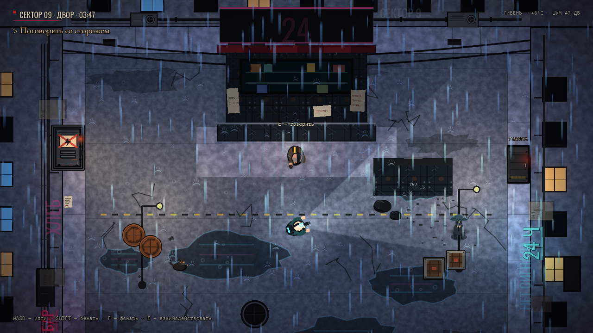
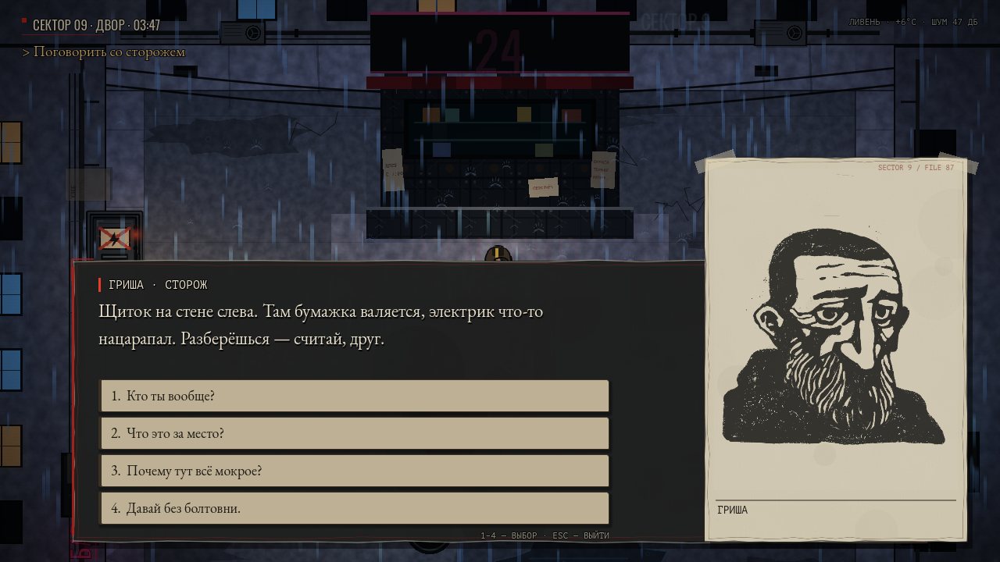
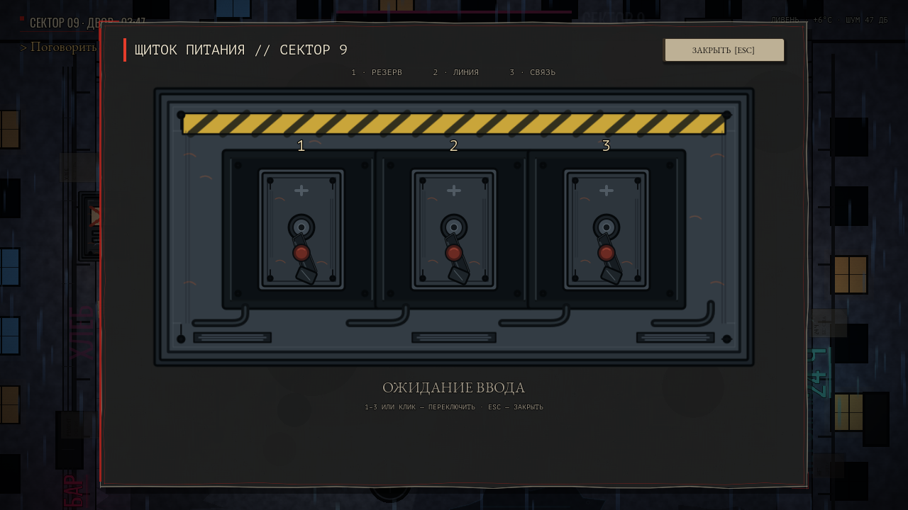
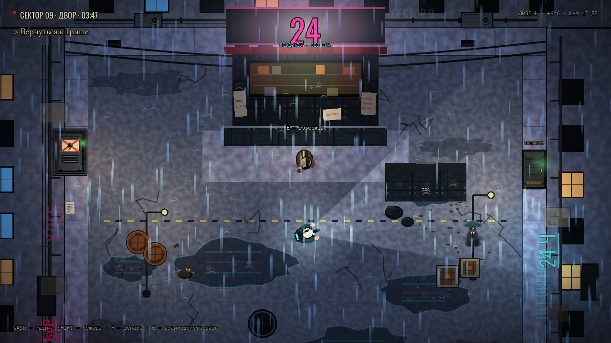
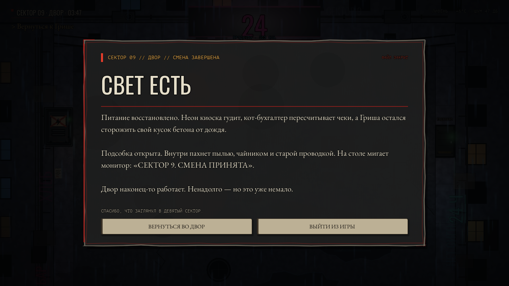

# Sector 9 — вертикальный срез

Небольшая 2D top-down игра-исследование в депрессивном постсоветском киберпанк-дворе:
дождь, бетон, неон, мокрый асфальт и киоск, который очень хочет снова включиться.
Это не шутер: здесь ходят, смотрят, разговаривают и чинят электрику.

В срезе есть один двор, главный герой, сторож Гриша, диалоги с выборами,
записка-подсказка и щиток с головоломкой. Прохождение занимает пару минут.



## Что в срезе

- Один цельный двор: мокрый асфальт, лужи, стены, окна, трубы, провода, постеры и неон.
- Игрок с ходьбой, бегом, фонарём и шагами.
- Сторож Гриша: несколько диалоговых веток, портрет и разные реплики до/после включения света.
- Кот-бухгалтер: необязательный диалог, который меняется после включения питания.
- Девушка с зонтом: атмосферная ветка диалога с подсказкой про подсобку и другими репликами при свете.
- Записка со скрытой подсказкой.
- Щиток с последовательностью **2 → 3 → 1**.
- Включение питания: неон киоска, свет в окне, новая цель и новая реплика Гриши.
- Подсобка за киоском: ключ от Гриши, финальный диалог и карточка завершения среза.
- Атмосферный звук: дождь, дальний город, гул неона, гром, прохожие, шаги, щелчки щитка.
- Интерфейс в духе рисованного комикса: тёмные грязные панели, бумажные клочки, крупный портрет.



## Запуск

### Готовая Windows-сборка

Скачай архив из [Releases](https://github.com/avg-imm0/sector9-final/releases/latest), распакуй в любую папку и запусти
`Sector9.exe`. Установка не нужна.

### Из исходников

Самый простой способ — `play.cmd` в корне проекта. Редактор открывается через
`open_editor.cmd`. Если игра не запускается, запусти `play_debug.cmd`: он оставит
консоль открытой и покажет текст ошибки.

Или из терминала:

```powershell
cd путь\к\папке\проекта
godot --path .
godot --editor --path .
```

Проект собран на Godot 4.7.2 (GDScript, GL Compatibility), но открывается и на 4.4.1.
Скрипты `play.cmd`, `play_debug.cmd` и `open_editor.cmd` сами ищут Godot 4.7.2,
затем сборку 4.4.1 в `C:\Program Files\Godot_v4.4.1-stable\`, затем `godot` в `PATH`.
Если ничего не найдено, установи движок: `winget install GodotEngine.GodotEngine`.

## Управление

| Клавиша | Действие |
| --- | --- |
| `WASD` / стрелки | движение |
| `Shift` | бег |
| мышь | направление взгляда и фонаря |
| `F` | включить/выключить фонарь |
| `E` | взаимодействие: диалог, записка, щиток |
| `E` / `Space` / `Enter` | следующая реплика, пропустить печать |
| `1`–`4` | выбрать вариант ответа |
| `1`–`3` / клик | переключить тумблер в щитке |
| `Esc` | закрыть диалог/щиток; в мире — выйти из игры |
| `Esc` на финальной карточке | вернуться во двор |

## Что происходит в срезе

1. Поговорить с Гришей у киоска. Он рассказывает про щиток и оставляет зацепки в боковых ветках диалога.
2. Найти на стене слева записку. В ней спрятана последовательность: **2 → 3 → 1**.
3. Открыть щиток и ввести `2`, `3`, `1`. Ошибка сбрасывает ввод.
4. После решения включается неон киоска, меняется цель, а у Гриши появляется новая реплика.
5. Вернуться к Грише: он даёт ключ от подсобки.
6. Открыть подсобку в правой стене, дочитать финальный диалог и увидеть карточку завершения среза.
7. По пути можно погладить кота-бухгалтера и поговорить с девушкой под зонтом: у обоих свои ветки диалога и отдельные реплики после включения света.







## Как устроена система диалогов

Диалоги полностью data-driven: контент лежит в JSON, а интерфейс строится кодом.
Чтобы добавить разговор, не нужно создавать сцену или трогать UI.

### Данные

Файл: `data/dialogue.json`. Верхний ключ — это id диалога.

```json
{
  "intro": {
    "speaker": "ГРИША · СТОРОЖ",
    "portrait": "grisha",
    "lines": [
      "Слышь, бродяга. Ты не из управы?",
      "Киоск закрыт. Но для хороших людей — почти открыт."
    ],
    "choices": [
      { "text": "Кто ты вообще?", "next": "who" },
      { "text": "Давай без болтовни.", "next": "pass" }
    ]
  },
  "who": {
    "speaker": "ГРИША · СТОРОЖ",
    "portrait": "grisha",
    "lines": ["Гриша. Двадцать лет на заводе, тридцать — на пенсии."],
    "choices": [
      { "text": "Понятно. Вернусь к делу.", "next": "intro" }
    ]
  }
}
```

Правила простые:

- `speaker` — имя в заголовке панели;
- `portrait` — необязательный ключ; файл ищется как `assets/portraits/<portrait>.png`;
- `lines` — массив реплик, каждая показывается отдельной страницей с эффектом печатной машинки;
- `choices` — необязательный массив кнопок; `next` — id следующего диалога;
- если `choices` нет, после последней реплики диалог закрывается по `E`;
- если `next` пустой (`""`), выбор закрывает диалог;
- после закрытия `Dialogue.last_finished_id` хранит id последнего диалога — по нему NPC понимает, что разговор закончился;
- `Dialogue.current_id` хранит текущий id, пока диалог открыт.

### Код

- `scripts/dialogue_manager.gd` — автозагрузка `Dialogue`. Загружает JSON, создаёт
  `CanvasLayer` с панелью, бумажными кнопками и карточкой портрета, запускает печать
  текста, обрабатывает ввод и переходы между ветками.
- `scripts/npc.gd` — пример использования: по `E` вызывает `Dialogue.start(...)`,
  а по сигналу `Dialogue.dialogue_finished` двигает цель. После включения света
  выбирает уже другую ветку — `intro_powered`.
- `scripts/interactable.gd` — общий компонент «подойди и нажми E». Его же используют
  записка и щиток.
- `scripts/ui_theme.gd` — шрифты, палитра и бумажные кнопки.
- `scripts/ink_panel.gd` — рисованные панели: тёмная «тушь» и светлая «бумага».

Типографика и скорость печати настраиваются в одном месте: `CHARS_PER_SECOND` в
`dialogue_manager.gd`. Сигналы `dialogue_started` и `dialogue_finished` можно
использовать для анимаций, блокировки движения или озвучки.

## Звук

`scripts/audio_manager.gd` — автозагрузка `Audio`. В срезе нет озвучки персонажей,
только атмосфера и звуки действий:

- дождь, дальний транспорт и гул воды в сливе — зацикленные подложки;
- гул неона, который включается вместе с питанием;
- редкие раскаты грома и проходящие по двору шаги;
- шаги игрока, щелчок тумблера, короткое замыкание, нарастающий гул включения;
- тихий стук печатной машинки и щелчок интерфейса.

В headless-тестах звук отключён, чтобы проверки оставались быстрыми и тихими.

## Визуальный стиль и ассеты

- Асфальт, бетон, окна, лужи, провода, граффити и отражения генерируются кодом в `scripts/world.gd`.
- Щиток, тумблеры, кабели, неон, дождь и брызги — авторские SVG и код.
- Бумажная текстура сгенерирована процедурно для этого проекта.
- Портрет Гриши — портрет из бесплатного пака Strangers Vol.1 (CC BY 4.0).
- Шрифты — EB Garamond, PT Mono и Oswald под SIL OFL 1.1.
- Звуки дождя, города и неона — бесплатный CC0-пак Rainy City Ambience.
- Щелчок щитка — CC0-звук с OpenGameArt.

Полные ссылки, авторы и тексты лицензий: [`assets/LICENSES.md`](assets/LICENSES.md).
